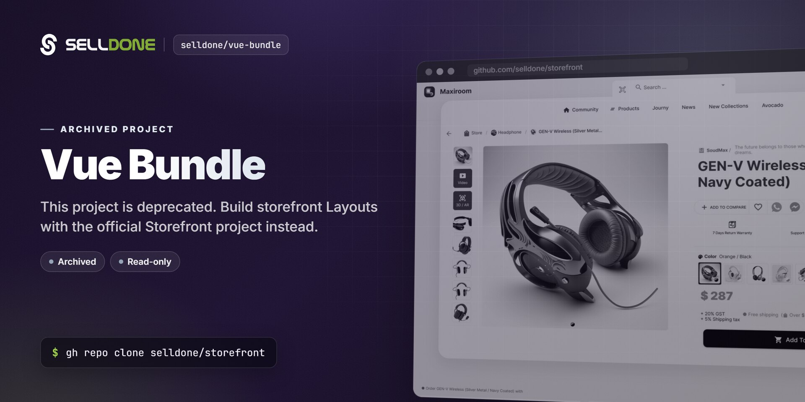
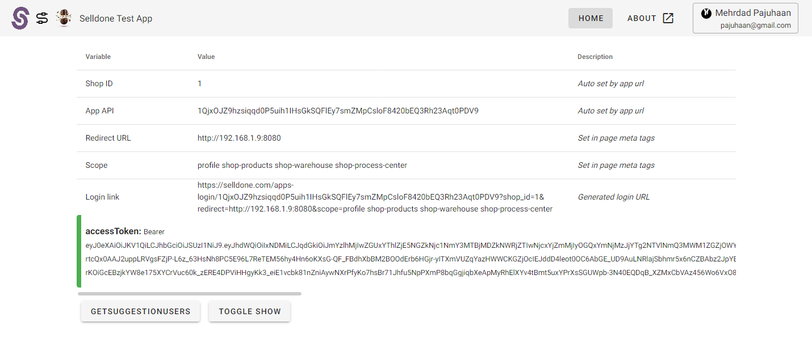

<p align="center">
  
</p>

<p align="center">
  
  <a href="https://www.npmjs.com/package/@selldone/vue-bundle"></a>
  <a href="LICENSE"></a>
  <a href="https://selldone.com"></a>
</p>

<p align="center">
  <a href="https://github.com/selldone/storefront">Storefront</a> ·
  <a href="https://github.com/selldone/pagebuilder">Page Builder</a> ·
  <a href="https://github.com/selldone/components">Components</a> ·
  <a href="https://github.com/selldone/storefront-sdk">Storefront SDK</a> ·
  <a href="https://github.com/selldone/backoffice-sdk">Backoffice SDK</a> ·
  <a href="https://github.com/selldone/vendor-sdk">Vendor SDK</a> ·
  <a href="https://github.com/selldone/community-sdk">Community SDK</a> ·
  <a href="https://github.com/selldone/core">Core</a> ·
  <a href="https://github.com/selldone/cli">CLI</a> ·
  <a href="https://github.com/selldone/translate">Translate</a>
</p>

> [!CAUTION]
> **This repository is archived and deprecated.** It is no longer maintained and will not receive updates or security fixes.
> To build storefront layouts on Selldone, use the official project: **[github.com/selldone/storefront](https://github.com/selldone/storefront)**.

## What it was

**Vue Bundle** (`@selldone/vue-bundle`) was a ready-to-use Vue 2 project that helped developers create apps for merchants on the **Selldone®** store builder and e-commerce platform. It was built with Vue CLI 4, TypeScript, Vuetify 2, Vue Router and Vuex, and included a small API layer (`ShopApi`, `UserApi`) and an OAuth-style flow that read the app API key and shop ID from the URL and the redirect URL and scopes from `<meta>` tags.

The Selldone open-source ecosystem has since moved to Vue 3 and dedicated packages that replace every part of this bundle.

## Migration

| If you used… | Use this instead |
|---|---|
| The Vue 2 project scaffold (Vue CLI, Vuetify 2, router, store) | **[Storefront](https://github.com/selldone/storefront)** — production-ready Vue 3 + Vite storefront (a Selldone *Layout*). |
| `window.Selldone`, `ShopApi` / `UserApi` and the axios setup for customer-facing calls | **[Storefront SDK](https://github.com/selldone/storefront-sdk)** — `@selldone/sdk-storefront`, available as `window.$storefront`. |
| Building your own UI widgets for shop pages | **[Components](https://github.com/selldone/components)** — `@selldone/components-vue`, pre-built Vue 3 commerce components. |
| `yarn build` and manual upload | **[Selldone CLI](https://github.com/selldone/cli)** — `selldone-cli`, build, zip and deploy a Layout to Selldone. |

For admin or merchant-side integrations (the "Shop Owner API" mentioned below), see the [Backoffice SDK](https://github.com/selldone/backoffice-sdk).

<details>
<summary>Original setup instructions (historical reference)</summary>

<br>

> These instructions are kept for reference only. The toolchain (Vue CLI 4, Node 10, Vue 2) is outdated.

### API documentation

- [Selldone Shop Owner API Playground](https://selldone.com/apps/api/owner) — Selldone's API.
- [Selldone Shop Customer API Playground](https://selldone.com/apps/api/shop) — Selldone's XAPI *Customer APIs*.
- [Development documentation](https://selldone.com/help) and [Selldone Apps](https://selldone.com/apps).

### Project setup

```sh
# Installation
yarn install

# Compiles and hot-reloads for development
yarn serve

# Compiles and minifies for production
yarn build
```

### Test local application

Guide to run full feature Selldone applications on your local machine.

```sh
# Local app url
http://localhost:8000?api={api_key}&shop_id={shop_id}
```

You can simulate the app loading procedure by adding `shop_id` and `api` to your local app's URL query.

- **api_key** — Your application API key. Find it in Shuttle > Company > App > API Key.
- **shop_id** — Merchant shop ID. Find it in your admin store URL: `https://selldone.com/shuttle/shop/1` → `1`.



### Client config

You must set the **redirect URL** and **scope** with meta tags in your application page's header.

| Meta | Description | Required |
|---|---|:-:|
| `app-redirect-url` | Client app redirect URL | ✔ |
| `app-scope` | Access scopes | ✔ |
| `app-access-token` | Customer access token | ❌ |

```html
<!-- Page header (index.html) -->
<meta name="app-redirect-url" content="APP REDIRECT URL Ex. localhost:8000 or your-domain.com/sample-app">
<meta name="app-scope" content="ACCESS SCOPES HERE Ex. profile shop-products shop-warehouse shop-process-center">
```

#### Optional access token

The access token is saved in page sessions (`sessionStorage`). `sessionStorage` is similar to `localStorage`; the difference is that data in `localStorage` doesn't expire, while data in `sessionStorage` is cleared when the page session ends. You can save the access token in your secure database (your server) and provide it in the **app-access-token** meta tag.

```html
<!-- Page header (index.html) -->
<meta name="app-access-token" content="ACCESS TOKEN HERE">
```

</details>

## Security

This project is no longer maintained. Do not use it in new projects. To report a security issue in any active Selldone project, follow the [security policy](https://github.com/selldone/.github/blob/main/SECURITY.md) and email **security@selldone.com**.

## License

MIT License — Copyright (c) 2020 Selldone. See [LICENSE](LICENSE).

---
<p align="center"><sub>Part of the <a href="https://github.com/selldone">Selldone® Business OS</a> open-source ecosystem · <a href="https://selldone.com">selldone.com</a></sub></p>
